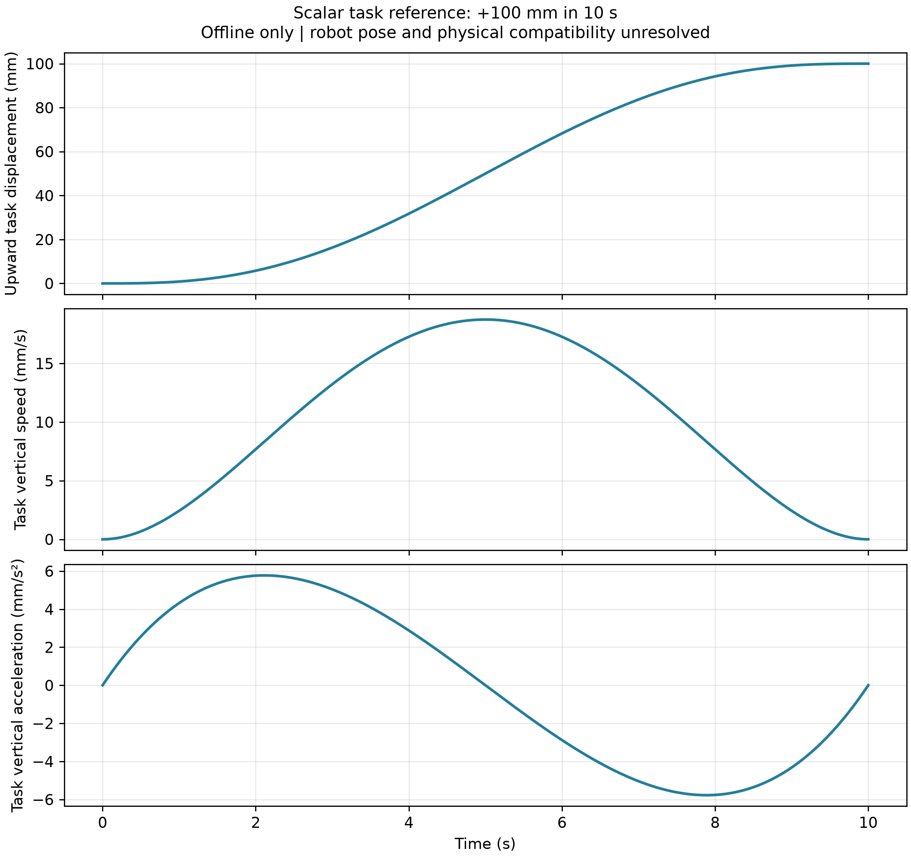

# 10秒上抬10厘米：当前准备结果与下一步

2026-11-22。操作者将上抬参考幅度从1毫米改为10厘米，总时间仍为10秒，目标是验证机械臂与假腿的联动，尚未执行自动带腿运动。操作者最新确认：机械臂已重新刚性接上近膝的小腿，两轴已停用，3C18均读回0。这是现场声明，本次只读程序不独立核实驱动或抱闸状态。

## 为什么先不回放空载轨迹

现有90秒曲线最高抬升约75.10厘米、最远Base +Y前伸约89.25厘米，固定工具朝向。髋基座固定、髋膝可转动且小腿刚性连接时，需要与关节运动相容的位置和朝向；把空载曲线缩短、减速，甚至只改成竖直上移1毫米，都不能证明约束相容。当前没有实测关节轴、髋中心和TCP到夹具的变换，也没有审核通过的带腿六维示教段。

此前髋关节3C18=−5是−5Nm的主动目标力矩，向上难推不能归因为操作者力气不足；重力、控制环、限速和实际限位都可能影响方向阻力。两轴现在已停用、目标为0，不能据此认为已经正常放闸并可被动牵引；停用可能使抱闸合上。不通过增加机器人力量或改变驱动力矩来试探。

## 已准备好的离线参考

文件在[10秒10厘米参考目录](../results/manual_lab/20261122_lift_reference_10s_100mm_v1/summary.json)：上抬10厘米、10秒、首尾速度与加速度为0，采用五次平滑曲线。理论峰速18.75毫米/秒（1.875厘米/秒），峰值加速度约5.773503毫米/秒²，共501个采样点。这里的上抬定义为机器人基座坐标+Z方向，尚未转换成本次刚性连接可达的完整位姿路径。

`scalar_task_reference.csv`只有时间、任务竖直位移、速度、加速度四列，**不是可执行TCP轨迹**；没有实际起点、工具朝向或关节映射，不能送入run。`ready_for_execution=false`保留。原90秒曲线、配置及保护阈值没有修改。



之前的[1毫米参考](../results/manual_lab/20261122_micro_lift_reference_10s_v1/summary.json)保留为历史版本；其生成器哈希对应提交`112a22c1`，不是当前100毫米生成器的哈希。此次只更新离线任务幅度，未放开刚性连接执行入口。静止采集步骤不变。

## 现在只做一次10秒静止观测

先保持装置受支撑、机械臂处于原厂静止状态；采集期间不手推、不点动，不重新使能或修改假腿参数。程序只读取机械臂实际TCP位姿和原始六维受力，不读取ADS、不发使能/模式/运动指令，也不替操作者控制或停止假腿。SDK连接仍可能影响厂商会话；发现装置活动时按原厂方式停止，不等待采集结束。

旧电脑进入已有仓库，以下每块单独执行。如果仓库已迁移，第一行使用实际路径：

```powershell
Set-Location 'C:\Users\liumai\fjx\rehab_robot'
git branch --show-current
git status --short
git diff --cached --name-only
```

应为`paper-personalized-load`。先保存现场已有记录，确认没有未提交或无关暂存内容，再更新；不reset、clean或自动覆盖：

```powershell
git pull --ff-only origin paper-personalized-load
if ($LASTEXITCODE -ne 0) { throw '更新失败，保留本地文件并停止。' }
$probePython = Join-Path (Get-Location) '.venv\Scripts\python.exe'
if (-not (Test-Path -LiteralPath $probePython -PathType Leaf)) { throw '找不到原有项目Python。' }
$probeParent = 'results/manual_lab/' + (Get-Date -Format 'yyyyMMdd_HHmmss')
New-Item -ItemType Directory -Path $probeParent -ErrorAction Stop | Out-Null
$probeSession = Join-Path $probeParent 'connected_static_before_lift_10cm'
Copy-Item -LiteralPath 'config/robot_connected_observe_only.json' -Destination (Join-Path $probeParent 'observation_config.json') -ErrorAction Stop
```

保持上述静止状态，执行这一条采集命令。它会连接真实机械臂读取数据；observe不需要`--live`，也不加`--empty-load`：

```powershell
& $probePython -X utf8 -m scripts.lab_session observe --config (Join-Path $probeParent 'observation_config.json') --session $probeSession --duration 10
$probeExit = $LASTEXITCODE
Write-Host "采集退出码：$probeExit；目录：$probeSession"
```

正常结束应显示`OBSERVATION_COMPLETE`，`round_status.json`中`motion_commanded=false`；该状态仅表示采集完成。保留整个目录，包括`report.md`、`round_status.json`和`robot/`内的实际位姿、受力、元数据及查询日志。失败同样保留，不删掉失败记录再重试，不放宽采集时效阈值。

该入口不启用运动执行器的力/力矩停止守卫，不能拿它监护另一程序的运动。原始受力也尚未证明是去除重力、工具载荷及偏置后的交互力，不能直接当作论文负荷改善结果。

## 回传及下一次真正联动的条件

先查看暂存区，再只加入本次目录：

```powershell
git diff --cached --name-only
git status --short
git add -- $probeParent
git diff --cached --stat
```

确认没有无关暂存内容后：

```powershell
git commit -m "Record connected static robot observation before 10cm lift"
if ($LASTEXITCODE -ne 0) { throw '提交失败，保留原目录。' }
git push origin paper-personalized-load
if ($LASTEXITCODE -ne 0) { throw '推送失败，保留本地提交，不要强推。' }
```

回传后先检查实际连接位姿、朝向、静止漂移和受力读取是否可用。静止数据本身仍不能证明上抬可行；真正自动联动前，还需确认正常放闸/关节状态、伸直端边界与停止方式，并用本次安装的几何或[带腿六维示教](ACTIVE_LEG_TEACHING_WORKFLOW.md)确定允许的小幅完整位姿路径。执行器需支持并审核对应朝向变化，继续保留现有刚性连接自动运动阻止。本次未提供自动run命令。

## 本次离线验证

生成器未导入设备接口；检查了501点、20毫秒间隔、有限数值、端点、单调上抬、解析极值和已有目录拒绝覆盖。仅用替代采集函数验证observe参数及`capture_dummy_leg=false`分支，没有连接设备。原90秒源文件与配置哈希未变；这些验证不代表真机联动已成功。
