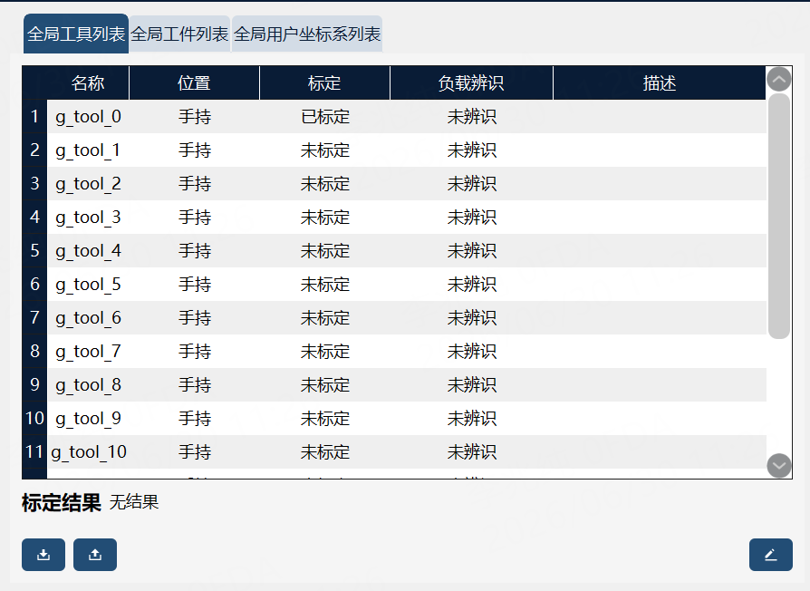
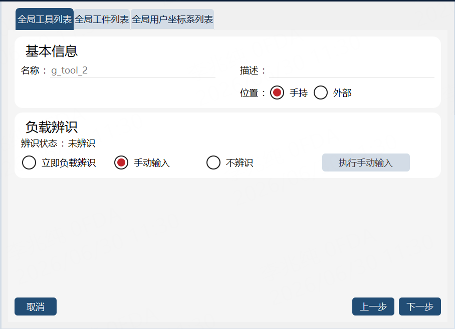
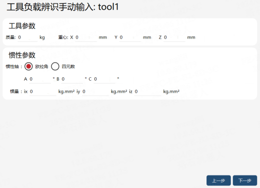

# 珞石示教器：工具/TCP与负载操作入口

2026-11-22。已在线核对珞石官方 **xCore V3.2** 手册，对应本机3.2.1控制器所属版本系列。设备为ROKAE XMC12-R1300-W7G3B4，现场SDK0.7.0。操作者已确认连接小腿后可顺畅原厂拖动、没有明显卡阻；该报告不等于自动路径或关节边界已验收。本次没有连接设备或修改参数。

## 最新：在辨识或运动按钮上出现“发送命令失败”

操作者报告提示发生在“执行辨识”“运动至”或其他涉及运动的按钮。当前先退出辨识流程，保留已有提示和日志，不再次触发、不通过反复上电或切自动模式试出原因。该提示没有对应到已确认的具体错误编号，不能直接归因为Python占用、权限、通信或未上电。

退出按钮位置已按官方8.12.2.4辨识页与9.7.1.3工具向导图核对：**机械臂停稳后，在负载辨识页右下角点击“上一步”；回到工具编辑向导后，点击左下角“取消”。** 不通过“下一步/完成”保存未知参数。翻页不是停止命令；若仍在运动，先用原厂停止方式处理，再退出页面。

下一步只查看已有日志：**顶部“日志” → “控制器日志”**，找到刚才失败时间附近的**编号、标题、内容**。若该时刻没有控制器记录，再查看 **日志 → HMI日志** 中的对应文字；不要为了产生新日志而重试失败动作。也可在 **日志 → 日志时间轴** 中按时间对应HMI和控制器记录。

HMI日志页面支持“导出日志”为CSV；需要完整文件时，官方14.4的入口为 **选项 → 导出 → 日志**，仅选择控制器日志/HMI日志及目标文件夹。无需打开额外诊断开关。当前等待具体日志，尚未定位或修复该报错。

本次之前的18:31采集记录显示当时正常断连；这不能证明发生新报错时控制器会话或运动条件的状态。没有新增设备连接、清错、重启、参数写入或运动命令。

## 当前只查看，不填写未知参数

保持机械臂静止，先记下顶部快捷栏当前“工具”和“工件”名称，保留现有选择。按官方V3.2入口查看：

1. 点击顶部 **设置**。
2. 左侧选择 **坐标系标定**。
3. 进入 **全局工具列表**。
4. 如果当前工具名为`g_tool_N`，找到同名项，选中后点击右下角的 **铅笔/编辑** 按钮。
5. 查看工具属性、位姿标定与负载参数；记录当前数值和单位，查看后 **取消** 退出，不保存未知参数。

编辑需“编程员”及以上权限。全局工具固定为`g_tool_0`至`g_tool_15`，只能编辑，不能新增/删除。下面是厂家示例图，图中状态和工具号不是本机已验收的设置：

官方手册部分总览截图与专门章节使用了不同修订界面。如果3.2.1设置侧栏没有“坐标系标定”，可从 **编程 → 工具列表** 查看工程工具；不要把机器人零点/力传感器“标定”页面当作工具负载入口。

## 如果当前名称是tool0

官方8.12.2明确规定：**tool0的工具坐标系与法兰坐标系重合，动力学参数全为0，且不可修改。** 因此前次SDK读到全0不能直接判为错误，仍需核对实际选择。`tool0`与可编辑的全局工具`g_tool_0`是不同名称。

工程工具入口为 **编程 → 工具列表**，右下角 **+** 用于新建；全局工具则在上面的全局列表编辑已有槽位。取得实测参数、确认目标工具用途并保留原配置后，才定义夹具工具，不随意覆盖既有工具。

顶部快捷栏“工具”选择决定Jog使用的工具；RL运动语句中的工具参数需单独核对。几何记录与后续执行应保持同一参考点定义。

## 取得实测数据后，负载在哪里输入

官方9.7.1.3的全局工具向导入口为：

**工具属性：手持 → 负载辨识：手动输入 → 执行手动输入 → 工具负载辨识参数页。**

先确认单选项在“手动输入”，右侧按钮文字应为 **执行手动输入**。若仍显示“执行辨识”，不要点击；该按钮仍属于自动辨识流程。当前参数未知，只查看后取消，不点击“运动至”或运行辨识。

“手持”指工具固定在法兰上、随机器人运动；机械臂端夹具属于这类附件，假腿髋基座固定不使末端夹具变成外部固定工具。当前先查看，尚未取得实测数据时不填写或保存。

| 参数 | 官方示例页面单位 | 数据来源 |
|---|---|---|
| 质量 | kg | 机器人端固定附件的实测质量 |
| 重心X/Y/Z | mm | 同一坐标定义下实测或CAD重心 |
| 惯量 | kg·mm² | 与所选惯性坐标系/表达方式一致的实测或CAD惯量 |
| 惯性轴姿态A/B/C | ° | 对应惯量表达所需的方向参数 |

图中0均为厂家界面示例，不是本机建议值。以实际页面单位为准；SDK里的米、千克·米²不能原样填进毫米、千克·毫米²字段。未知质量、重心或惯量时保留未知，不填0冒充标定；当前静止12.62N也不能除以重力加速度就当作夹具质量。

TCP几何与负载是两组参数。已知夹具相对法兰的位姿时可按官方“手动输入”填写几何；未知时需适用的原厂四点法/六点法等标定，不猜测夹具长度或朝向。

## 这些参数表示什么

### 关于“拖动时力矩偏差过大”

操作者反馈：不把假腿负载填入当前生效的工具/工件负载模型时，ROKAE拖动会报“力矩偏差过大”。这说明拖动控制器确实在用动力学负载模型；**正确做法不是保持零负载硬拖，也不是把整条假腿随意填成一个刚体。** 我此前“不要把整条假腿导入”的说法不完整，准确边界如下：

- 负载模型至少应包含**机器人法兰上固定、并与法兰刚性一起运动的部分**：连接板、夹具，以及确实被夹具刚性带动的局部小腿组件。质量、重心和惯量要来自称量、尺寸/CAD或适用的原厂辨识。
- 不应把固定在实验台上的髋基座、可相对转动的整条大腿/膝/脚机构，合并成一个固定刚体质量填入。它们对法兰产生的是随姿态、重力力臂、摩擦、加速度和主动关节力矩变化的外部反力矩。
- HMI里的“工件坐标系”首先是几何参考；如果当前RobotAssist把负载字段放在机器人持有的工件对象上，应记录该对象的`robhold`、名称和数值，但不能把“填在工件页”理解成已经建立了假腿的完整动力学模型。不要为了消除报警而切换成外部工具/工件语义或关闭力矩偏差保护。

因此，本装置不存在一个能在全程准确代表整条假腿的恒定负载值。输入机器人端刚性附件的负载，只是帮助拖动补偿机器人端已知重力；连接固定髋基座后仍可能有明显的姿态相关反力矩。若输入实测的机器人端刚性附件后仍报偏差，应优先判断为外部约束/驱动状态/工具选择问题，不要继续增大质量直到报警消失。

推荐顺序是：先退出自动辨识并保留当前日志；记录当前工具名、工件名、`robhold`及负载字段；测量机器人端刚性附件的质量和重心后用手动输入；在腿与固定基座解除或处于原厂允许的自由状态下验证拖动；重新接回后只做受支撑的小幅手动确认。自动负载辨识不能在这套刚性受约束结构上直接运行。

对本次“固定髋基座、髋膝转动、机械臂夹在近膝小腿处”的装置，定义应按机械关系划分：

| 部分 | 本次如何理解 |
|---|---|
| 法兰上的连接板、夹具及固定附件 | 可定义为机器人手持工具；质量、重心、惯量按实物确定 |
| 整条带髋膝关节的假腿 | 外部受约束的交互机构，是实验对象；不能整体等同于自由悬挂的刚性工具负载 |
| 固定髋基座/实验台 | 可以作为外部工件坐标系的固定参考；设置坐标系不等于建立假腿动力学模型 |

从实验用途可以把假腿称作被操作的对象，但不能由“工具/工件”名称自动推导其重力补偿方式。小腿若确实与夹具形成同一刚体，理论上可纳入经审查的复合刚体补偿；整条关节腿仍不能合并为一个固定刚体。当前需明确补偿覆盖哪些零件，不能由“只填夹具”推断全部动力学配置已正确。

**抬升时物理质量不变，机械臂承担的力与力矩会变化。** 姿态改变会改变重力力臂及髋基座与机械臂之间的载荷分担；关节摩擦、速度/加速度及主动髋膝力矩也影响末端读数。沿运动方向感受到的等效惯性可以随关节姿态变化，但这不是物理质量增加或减少。

固定工具自身的质量、重心和惯量在工具坐标系中保持固定；其重心在世界坐标系的位置随运动改变。不能为了拟合每个姿态的受力而动态修改工具质量，也不能用连接状态下的力除以重力加速度估算夹具质量。

论文评价应在相同安装、相同假腿驱动状态和相同补偿范围内，比较实际交互力/力矩的RMS与峰值。路径/节奏导致的机械负荷改变是待检验结果；更换补偿范围或改变主动助力本身造成的下降不能计为轨迹算法收益。本次建模说明不等于已经完成补偿标定或放行自动轨迹。

- **工具/TCP**：约定的工具参考点及其方向相对机器人法兰的位置。若故意以法兰为参考点，零偏移可能是合理定义，不为消除“0”而随便填写尺寸。
- **负载**：机器人端实际固定附件的质量、重心和相应惯量，用于控制器的动力学补偿；需要称量、尺寸/CAD或适用的原厂辨识结果。重心不是随便填写的夹具长度。
- **假腿**：髋基座固定，关节与机械臂之间存在外部机构约束；整条腿不是可直接计入工具组的自由悬挂刚体。不能把整条腿重量填进工具质量，或将已连接时的静止受力清零来冒充工具标定。

工具质量与重心当前未知，不提供猜测数值，也不在代码中写入`setToolInfo`、`setToolset`或`setLoad`。先辨清现有定义和实际夹具。后续几何记录与回放必须保持同一坐标定义；改变工具/TCP后需重新核对记录与执行的含义。

没有完成物理夹具TCP标定，并不使所有只读几何记录失去价值：若实际使用固定的法兰原点约定，完整六维法兰位姿也可作为参考。应准确记录该约定并保持工具组不变，不以“必须把零改成非零”作为录制前提。现有录制器不单独保存工具负载元数据，不能声称它会自动验证当前设置。

## 当前不做自动辨识或多点标定

官方8.12.2.4说明自动负载辨识需先“运动至”辨识位置，再切到自动模式运行程序。这次机械臂与固定髋基座假腿刚性连接，所需运动条件尚未核实；先不启动自动辨识、多点标定或按照自由空间流程转动末端。需先按适用原厂流程安排支撑、解除外部约束及测量夹具。

这一步不是要求重新做静止采集；[18:31静止记录](lab/CONNECTED_STATIC_REVIEW_2026-11-22.md)已经完成。也不因工具名称看起来正常就放行10厘米自动上抬。确认坐标/工具条件后再用[带腿六维示教](ACTIVE_LEG_TEACHING_WORKFLOW.md)取得实际可达路径，完整保留朝向。

## 官方在线来源

- [V3.2 HMI简介，6.4.2、6.6、6.7](https://docs.rokae.com/docs/xCore/_versions/V3.2/06-hmi-简介/)：顶部功能与左侧子菜单，编程/设置模块分类。
- [V3.2 工具列表，8.12](https://docs.rokae.com/docs/xCore/_versions/V3.2/08-编程/工具列表/)：tool0、工具几何与负载、新建/手动输入及自动辨识条件。
- [V3.2 坐标系标定，9.7](https://docs.rokae.com/docs/xCore/_versions/V3.2/09-设置/坐标系标定/)：全局工具列表与编辑向导。
- [V3.2 动力学设置，9.8](https://docs.rokae.com/docs/xCore/_versions/V3.2/09-设置/动力学设置/)：动力学前馈/约束/振动抑制用途。
- [V3.2 日志，13.1、13.2、13.4](https://docs.rokae.com/docs/xCore/_versions/V3.2/13-日志/)：HMI日志、控制器日志与时间轴。
- [V3.2 选项，14.4](https://docs.rokae.com/docs/xCore/_versions/V3.2/14-选项/)：日志导出。

官网默认打开V4.0，本次明确选V3.2归档。三张官方图已保存供离线查看；URL、页面HTML哈希与图像哈希见[sources.json](references/rokae_xcore_v32/sources.json)。图片均已查看，未修改原图。

## 本地SDK交叉核对

- [SDK setToolset说明](../hardware/windows/xcoresdk/xCoreSDK_python/__init__.pyi)：`setToolset`段说明RobotAssist右上角与默认工具/工件选择；工具组用于SDK，不等同于RL工程。
- 同文件`toolset`、`toolsInfo`、`WorkToolInfo`及`Load`：分别区分SDK工具组、工程工具列表、工具名称/位姿与负载，负载质量单位千克、重心单位米。
- [适配器读取](../hardware/windows/rokae_xcore.py)的`get_tool_payload_metadata`只读SDK返回值，保留`active_hmi_tool_workobject_verified=false`，不声称已经确认当前示教器选择。

本次只有公开资料检索、离线核对与文档更新，没有连接设备、切换工具、写参数或执行运动。
