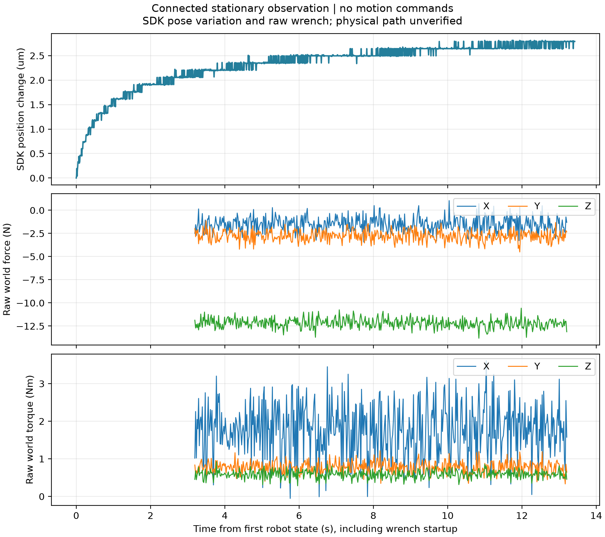

# 18:31连接后静止采集复核

2026-11-22。原始记录由提交`cf55b9aa`回传，采集代码为`c255d772`。会话为`results/manual_lab/20261122_183143/connected_static_before_lift_10cm`。本次仅离线读取已保存文件，没有连接或控制设备。

## 结论

本次10秒静止采集正常完成，机器人状态与受力读取可用，无需重复这次静止观测。它没有发送轨迹命令，也没有验证机械臂带腿运动；10厘米/10秒仍是离线任务参考。

| 项目 | 复核结果 |
|---|---|
| 机器人状态 | 1670条，全部有效；含启动过程约13.422秒，约124.346Hz |
| 原始受力 | 501条，全部有效；查询起点跨度10.0134秒，约49.933Hz |
| 对齐记录 | 前159条为约3.183秒启动等待；就绪后501条全部有效，无中途失效 |
| 最大受力间隔 | 查询起点27.48毫秒、中点29.67毫秒、发布31.89毫秒；没有超过40毫秒的间隔 |
| SDK位置相对首点最大变化 | 约0.00281毫米；这是静止读数变化，不代表绝对定位精度 |
| SDK朝向相对首点最大变化 | 约0.000233度 |
| 平均SDK位置XYZ | 约`[0.73611286, -0.06350166, 0.27457773]`米 |
| 原始world力模长 | 均值12.62牛，最大14.43牛 |
| 原始world力矩模长 | 均值2.05牛米，最大3.79牛米 |
| 指令与退出 | 0条轨迹命令；501次查询成功；正常退出并完成SDK断连，无强制结束 |

`metadata.json`关闭后的`healthy=false`和`ready=false`属于日志器终态，不能单独当作故障。这里的`logger.status=completed`、`failure_reason=null`和`NORMAL_CLEANUP=true`互相一致。



## 尚未确认的实际安装信息

SDK读取的工具偏移、工具质量、重心及惯量均为0，`active_hmi_tool_workobject_verified=false`。这只说明SDK会话中的返回值，不能断言示教器当前工具配置一定错误；也不能据此把记录原点认作已标定的夹具TCP。下一步需核对示教器实际选用的工具/TCP和负载。

原始world受力尚未核实工具/重力补偿、无接触偏置、作用参考点和符号，不能直接称为真实关节负荷或将带腿静止均值清零来代替标定。本次没有ADS采集，未观察两轴模式、抱闸、关节角度或伸直端限位；静止稳定不能证明已经正常放闸。

固定髋基座、两转动关节和近膝小腿刚性连接，对TCP位置与朝向有共同约束。单个静止点不能确定这条可达位姿路径，低速度也不能消除几何冲突。当前执行器仍要求固定朝向，旧设计器会丢弃录制朝向，刚性连接自动执行阻止继续保留。

## 下一步只补可达路径，不重复静止采集

操作者已回复：连接状态下可顺畅原厂拖动、没有明显卡阻；但不会设置示教器。当前先按[珞石工具查看步骤](../ROKAE_TOOL_SETUP_WORKFLOW.md)保留当前选择、查看实际工具/TCP与负载。工具参数与关节边界仍未独立验收，不将未知项填成已通过。

若尚未确认正常释放或仍有方向阻力，先处理该状态，不用机械臂硬拉，也不以增加力矩验证。若上述条件已确认，则按[带腿六维示教流程](../ACTIVE_LEG_TEACHING_WORKFLOW.md)录30～60秒缓慢上抬与返回的参考几何；不要求现场10秒走完，也不强求纯竖直直线或固定工具朝向。记录器只读，不替操作者放闸、控制或停车。

之后审核实际XYZ与朝向、可达行程和数据缺口，再提取上抬段、离线重定时到10秒。自动回放还需补齐并验证相应朝向执行支持；仅收到示教文件也不直接放行run。现有90秒曲线及保护阈值均未修改。

## 离线复算

结果及输入哈希见[review.json](../../results/manual_lab/20261122_183143/connected_static_before_lift_10cm/review_20261122/review.json)。以下仅读取已有文件，输出目录必须尚不存在：

```powershell
.\.venv\Scripts\python.exe -X utf8 -m scripts.review_static_robot_observation --session results/manual_lab/20261122_183143/connected_static_before_lift_10cm --output-dir .cache/connected_static_review_recheck
```

原始文件保持不变。独立复核计算得到相同的计数、位姿变化、受力模长与间隔，图像已查看；本次没有运行真机测试。
