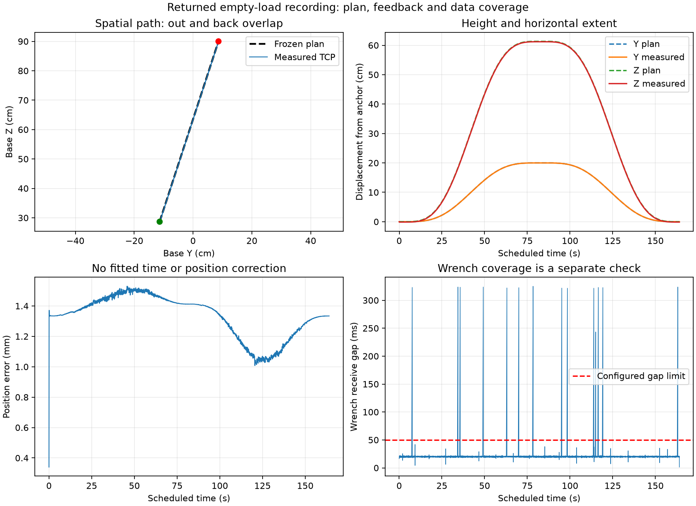

# 本次空载路径与新示教方向

回传提交`85f4c224`，空载目录`results/manual_lab/20261114_174300/empty_full_tcp_20261114_174525`。本页为原始数据离线复核，不修改既有计划、配置、状态或原始CSV。

## 路径问题的定位

冻结起点约为基座坐标`(0.754227, -0.113553, 0.286670)m`，计划峰点为`(0.754227, 0.086447, 0.900000)m`。即X不变、Y增加200mm、Z增加613.330mm，164秒内上抬、保持、原路返回。0.9m是绝对基座Z高度，不是相对抬升量。

当前生成器把同一个进度乘在整个水平/高度位移上，所以空间路径是直线。七阶时间函数只平滑时间变化，并不会生成康复弧线。原关节参考经名义几何变换形成的是另一条曲线，不能把这次独立直线说成旧康复轨迹的原样重定时。

1641条命令与计划目标一致。用记录的schedule origin直接对齐，实测位置RMS误差约1.341mm、最大1.539mm；实际最高Z约0.898653m，水平Y约增加199.931mm。主要大行程按计划执行，未见米/毫米或重复坐标变换造成的大幅执行偏差。现场的实际任务方向、TCP/工具定义和幅度是否适合，仍须独立核对，不能由跟随误差小替代。

回程相对最初anchor仍偏约1.334mm，类似偏移在开始保持阶段已经存在；1mm诊断也有同方向启动偏移。没有事后拟合时间或减去位置偏置来取得较小误差。已有日志不覆盖后续断使能后的全部物理行为，不能排除日志结束以后发生的下沉。



精确计算保存在同目录`review/review.json`。可在纯离线环境重新生成到一个新目录：

```powershell
.\.venv\Scripts\python.exe -X utf8 -m scripts.review_empty_recording --session results/manual_lab/20261114_174300/empty_full_tcp_20261114_174525 --output-dir .cache/new_empty_review
```

## 受力证据没有完整通过

全周期受力记录有14处超过50ms的接收间隔，最大约325.033ms；运动内192条对齐快照无效。事件审计另记录14次原生查询超预算，最大302.6102ms，以及收尾`ack_timeout`/未确认审计邮箱清理。只看成功查询CSV的最大28.045ms会漏掉异常边界证据。

因此现有离线审核返回`wrench gap in motion; no interpolation across missing data`。`EMPTY_LOAD_COMPLETE`表示运行器的完成状态，不能独立证明数据可用于论文受力端点；RT停止标志为true也不代替受力子进程正常清理。关闭后的`logger.healthy=false`本身不是故障原因，关键是实际缺口和清理事件。

本次没有放宽50ms门限，也没有填补缺口后声称合格。拖动录制仅记录state，暂时与受力查询链分开；它不解决受力测量质量，正式学习前仍需另行处理。

## 假腿新数据

17:40的十秒诊断仍保留轴1`0x0218 / 0x0022`；17:43后的诊断、probe和正常采集回到`0x0231 / 0x0000`。状态变化的现场原因未记录，不能写成软件修复的结果。

新正常采集4968行、约9.9991秒，平均约496.745Hz；四轴本段均无fault/非零错误、未使能。质量报告仍有接收缺口、最大约41.511ms和低于500Hz筛查，`usable_for_dynamics=false`。不能仅因guard通过把完整测量链验收为已完成。

## 已确定的后续方向

用户希望录制合适幅度的康复路径，最终选择原厂拖动示教，取代刚才对低速点动的临时回答。只读录制、离线预览与回传见[拖动示教操作手册](../DRAG_TEACHING_WORKFLOW.md)。路径先由真实示教和预览确认，不再默认使用当前61.3cm/20cm的大行程。

未来将确认后的TCP空间曲线作为有明确来源的新任务，再在统一周期内调整节奏，仍使用机器人受力学习。固定姿态执行器、TCP/工具一致性、完整路径/速度加速度审查及受力采集仍须分别接通；当前没有录制后自动回放能力。未取得真实示教之前，不自动猜幅度、缩放旧曲线或生成新的真机运动指令。

本页离线重算入口已纳入[557项回归](../validation/PAPER_BRANCH_TESTS_2026-11-14_DRAG_TEACHING.xml)，其中直接重放本次归档数据，核对61.3cm/20cm计划、约1.539mm最大跟随误差、14处受力缺口与离线审核拒绝，并确认原始反馈文件未被改写。该软件检验不将不合格受力记录变成合格数据。
